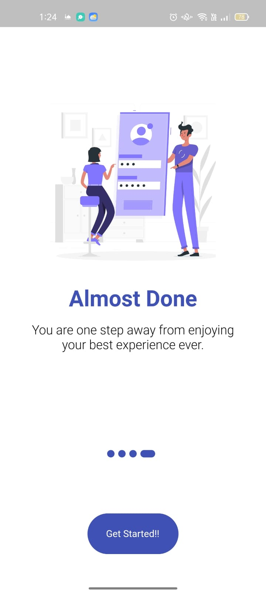
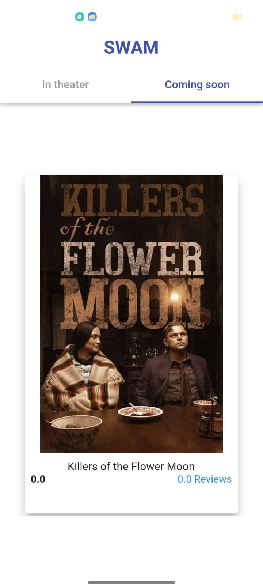
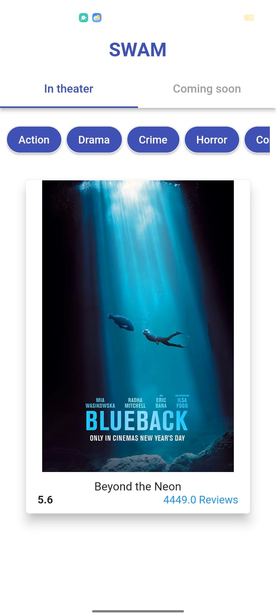
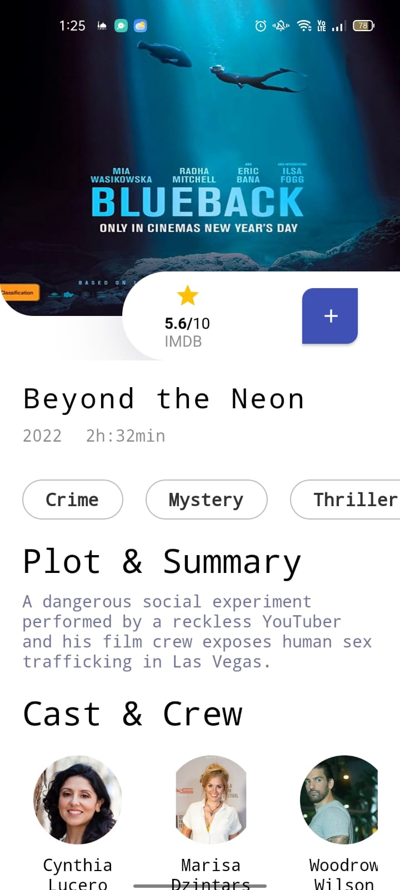
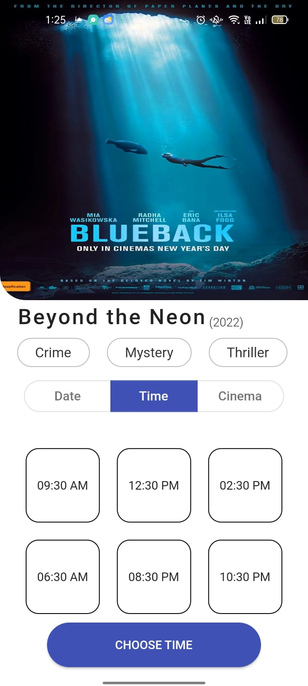
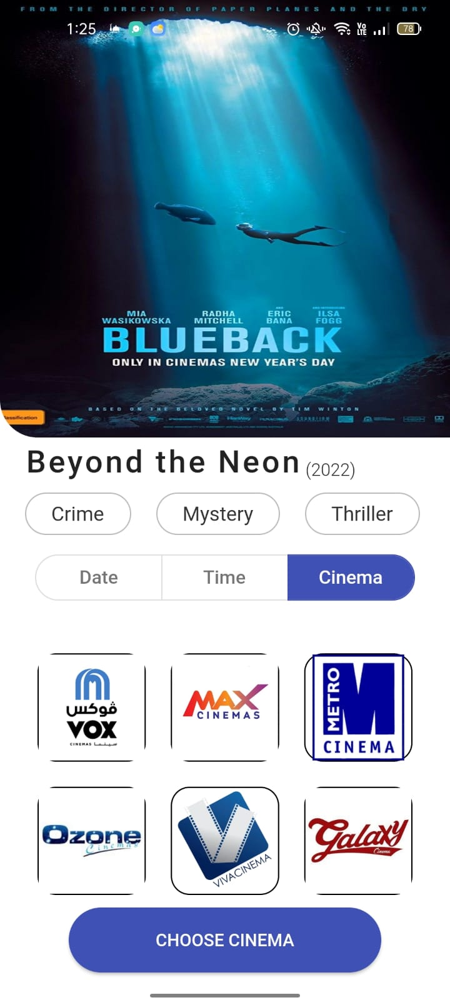
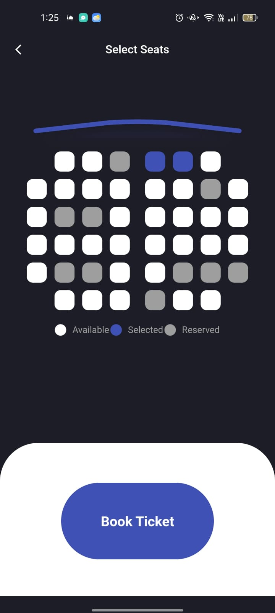
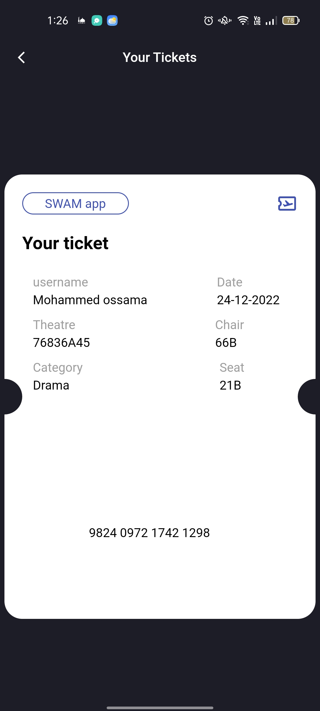

<div align="center">
  <h1> 🎬 SWAM Cinema UI </h1>
  <p><b>A sleek Movie Booking UI developed as a frontend task during the ITI Flutter Track.</b></p>
</div>

<br />

## 📱 Project Overview
**SWAM** is a cinema booking application interface designed to provide a smooth browsing experience for movie enthusiasts. This project focuses on high-quality UI/UX patterns, including custom tab navigation and snapping list interactions. It was built to master layout composition and third-party UI library integration during the **Information Technology Institute (ITI)** training.

### 🖼️ Screenshots
<div align="center">
  
  
  
  
  
  
  
  
</div>

---

## 🚀 Built With
This UI-focused project utilizes advanced Flutter widgets and specialized design packages:

* **Flutter & Dart** - Framework for high-performance UI.
* **Scroll Snap List** - For the center-focused, interactive movie carousel.
* **Ticket Widget** - To create professional, perforated ticket-style layouts.
* **Custom TabController** - Managed navigation between "In Theater" and "Coming Soon" sections.
* **Material Design 3** - Modern iconography and components.

---

## 🛠️ Key UI Features
* **Snap-to-Center Carousel:** Smooth horizontal scrolling that snaps movies into focus with dynamic scaling.
* **Category Filtering:** Horizontal quick-select buttons for genres (Action, Drama, Crime, Horror, Comedy).
* **Dual-Tab Layout:** Organized content structure using a synchronized `TabBarView`.
* **Ticket View:** Specialized UI for booking confirmations and movie details.
* **Responsive Layouts:** Handled using `Expanded` and `Flexible` widgets to ensure consistent display across devices.

---

## 💻 How to Run This Project
1. **Clone the repository:**
   ```bash
   git clone https://github.com/ahmed-mohamed74/cinema-booking-project.git